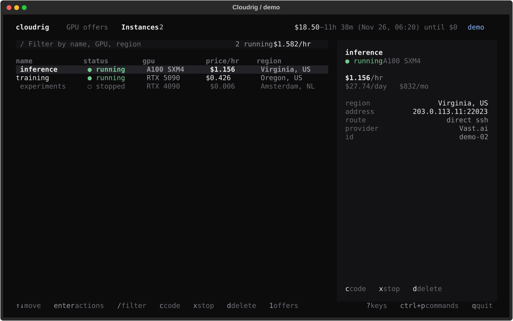

# Cloudrig

**Run cloud GPU experiments from your terminal — fast, simple, and agent-friendly.**

Run `crig` to open the interactive TUI and browse GPU offers or manage your rented GPUs.

<p align="center">
  
</p>

<p align="center">
  
</p>

## Supported Features

- **GPU search**: browse, filter, and sort live Vast.ai offers in the TUI or CLI (`--plain` / `--json`).
- **One-command VS Code**: injects a throwaway SSH key at boot, tries direct SSH before proxy, and cleans up on destroy.
- **Asynchronous VS Code warm start** prepares the remote editor while the GPU boots. Press `c` and keep working. VS Code opens automatically when the GPU is ready for it. [How it works](docs/architecture.md#vs-code-warm-start)
- **Agent-safe controls**: auto-mints a read-only key and a PIN-locked, no-billing action key. Rent, stop, and destroy confirm on `/dev/tty` with live price checks ([security details](docs/security.md)).

## Install

```sh
uv tool install git+https://github.com/junuxyz/cloudrig
crig
```

(I will make official PyPI distribution when ready)

Try `crig --demo` without an account. Currently supports macOS and Linux.

## Commands

```sh
crig                  # Open the dashboard (runs login on first use)
crig login            # Connect Vast.ai and set your PIN
crig logout           # Remove saved local keys
crig --gpu [QUERY]    # Browse GPU offers (e.g. crig --gpu 4090)
crig --rented         # List your rented GPUs
crig NAME code        # Open VS Code on a running GPU
crig NAME stop        # Stop a GPU (PIN required)
crig NAME destroy     # Delete a GPU (PIN required)
```

Add `--plain` or `--json` for script-friendly output. For example, `crig --rented --json` lists rented GPUs as JSON.

## License

[MIT license](LICENSE)
