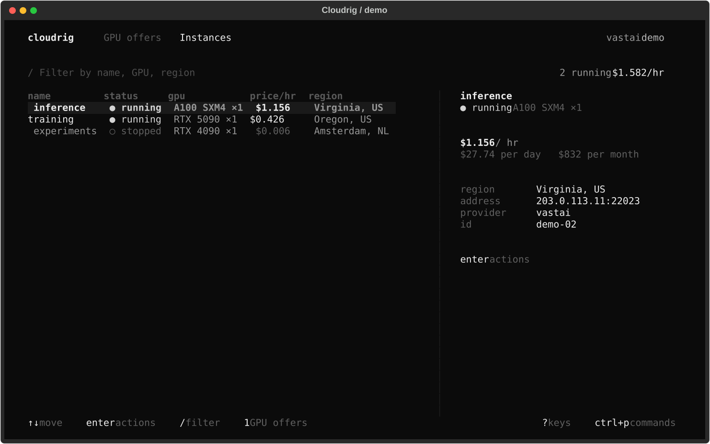

# Cloudrig

Rent a cloud GPU, open VS Code, stop it, and delete it from your terminal.



## Start

Download your platform wheel from [Releases](https://github.com/junuxyz/cloudrig/releases):

```sh
uv tool install ./cloudrig-*.whl
crig
```

Try `crig --demo` without an account. Supports macOS and Linux.

[Get started](docs/getting-started.md) · [Commands](docs/guide.md) · [Milestones](docs/milestones.md)

Experimental software built with AI assistance. [Verification](docs/verification.md) · [MIT license](LICENSE)
