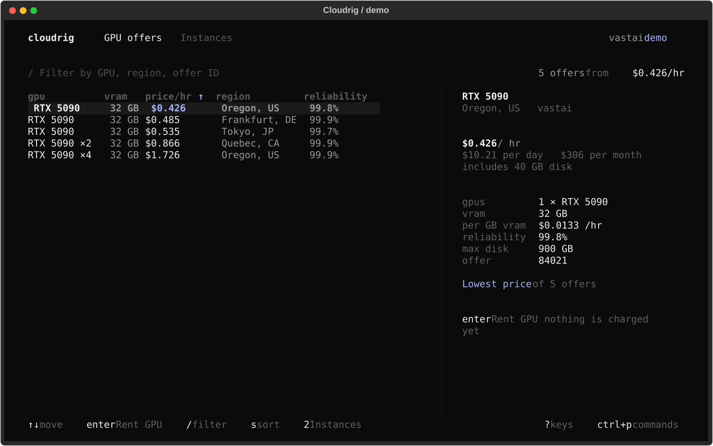

# cloudrig

Project-first prototype: run `uv run crig up . --demo --vram 32` to review a GPU and preview
opening this project remotely. See the [working prototype](docs/project-workspaces.md) and
[research, alternatives, and recommended next steps](docs/workspace-research.md).

For contributors, start with the [architecture](docs/architecture.md) and [coding conventions](AGENTS.md).

Find a cloud GPU, rent it, and get to work. One command: **`crig`**.



The Python CLI runs as your normal user. A separately installed native Go helper owns provider
API credentials and SSH private keys as root. Changing the CLI cannot grant it spending authority.
No containers, VMs, private-key copying, or custom cryptography are required.

## Preview without installing the privileged service

```sh
uv sync --group dev
uv run crig --demo --gpu 5090
uv run crig --demo --rented
```

Use arrows (or `j`/`k`) to choose, `/` to filter, `s` to sort, and Enter to review. `1` and `2` switch
between the market and your workspaces, and `ctrl+p` opens the command palette, including themes.
Demo mode never contacts a provider or the privileged service.

## Install

Requirements: macOS or Linux, Python 3.11+, Go 1.26+, sudo, OpenSSH **8.9+**, and rsync **3.5.0+**
on both endpoints for transfers. Use a current patched Go/OpenSSH release when building/installing.

```sh
uv tool install /path/to/cloudrig
cd /path/to/cloudrig
./scripts/build-admin.sh

# Review the installer and built artifact, then run from your own trusted terminal:
sudo -k /bin/sh scripts/install-admin.sh dist/cloudrig-admin
```

The installer copies the native binary into a root-owned location, installs the OS service, and
validates sudoers with `visudo`. It rejects existing `NOPASSWD` / `!authenticate` grants. **Sudo
credential caching is disabled for your account**, including commands outside cloudrig. This prevents
a cached generic `sudo sh` from bypassing the helper's fresh-authentication requirement. Do not
restore passwordless/cached broad sudo access while relying on this boundary.

The installer runs a root-level check that the configured ordinary UID cannot read a root-only
fixture and cannot validate sudo non-interactively. The unit suite does not substitute for this
actual installed check. Root installation has not been performed by the development agent.

Build as your ordinary user. The installer never runs Go, Python, or project package scripts as
root. The protected service never imports the editable Python CLI or reads project configuration.

## Connect your account

```sh
crig --set vastai             # Or runpod; ordinary local preference
crig login                   # Fresh sudo, then hidden API-key input in the root helper
crig --gpu 5090
```

Credentials are stored under `/var/db/cloudrig`, owned by root, mode 700/600. They are never returned
to the CLI, put into its environment, or copied into an AI agent's workspace. Provider environment
variables, Python keyring stores, and user-owned SSH private-key overrides are no longer used.
Use a new provider key and revoke any legacy user-readable copy when migrating.

Credential rotation revokes existing connection grants for that provider. Reauthorize connections
explicitly. The first version supports one configured local OS user per installation.

## Authority split

| Ordinary account | Fresh sudo authentication |
| --- | --- |
| GPU search and price comparison | Rent a GPU |
| Instance listing | Start a stopped GPU |
| Connect/execute on an approved GPU | Delete an instance |
| VS Code, file transfer, remote agent | Link/rotate provider credentials |
| Stop an approved GPU | Register/change SSH connection authority |

Resize, restart, volumes, top-ups, automatic payments, and budget changes are not implemented in
this release. The ordinary channel rejects them; there is no arbitrary provider-API passthrough.
A future implementation must be a separately reviewed privileged operation.

Each rent, start, delete, SSH authorization, and provider-key change requires fresh sudo
authentication. There is no additional typed approval code or confirmation prompt. The helper
prints the operation and current quote, then proceeds with its validation and price recheck.
`--yes` does not skip sudo. Credential login still asks for the API key with input hidden.
Run privileged actions in your own terminal; do not forward passwords or automate `sudo -S`.

If the local agent may have altered the CLI, use the installed helper directly from that terminal,
for example on macOS:

```sh
/usr/bin/sudo -k -- /Library/PrivilegedHelperTools/cloudrig-admin login vastai
```

Use `/usr/local/libexec/cloudrig-admin` on Linux. An editable program can fake a password prompt;
running it in another terminal does not make its code trustworthy.

## Search and rent

```sh
crig --gpu 5090
crig --gpu A100 --disk 100
crig --gpu 5090 --count 2 --sort price
crig --gpu 5090 --code .

crig --gpu 5090 --plain
crig --gpu 5090 --json
crig --gpu 5090 --rent OFFER_ID --name training --disk 40
```

Search is case-insensitive substring matching. Vast.ai includes verified, available, on-demand
listings with direct TCP connectivity. `--count` is a minimum on Vast.ai and an exact count on
RunPod. VRAM is per GPU. A `+` after a price means storage is extra and was not quoted.

Selecting a row does not spend money. After the local review, the protected helper obtains its own
provider quote and prints GPU/count/disk/image/location/rate in the terminal before allocation.
It refreshes the quote again before submitting. It ignores any price displayed or invented by the
unprivileged client. A provider may still change billing after allocation; this is not a provider
price lock or hard spending cap.

Root-owned pending receipts survive unrelated rentals. Ambiguous submissions are not retried
silently. The resource ID is stored before waiting for SSH. If startup is slow, check `crig --rented`;
the instance can already be billable. There is no automatic shutdown or TTL.
Recorded allocation names remain reserved despite stale provider listings or failed SSH setup.
A failed or ambiguous delete retains the record and revoked signing authority. Confirmed deletion
releases the name for a new rental.

## Work on approved GPUs

```sh
crig --rented
crig training ssh
crig training code .
crig training exec -- nvidia-smi
crig training agent codex     # Or claude, installed/authenticated on the remote machine
```

Names and exact provider IDs work. No-name commands use the last selected instance or the only
instance. `code .` opens `/workspace` remotely and does not upload the local folder. Install the
VS Code shell command and Remote - SSH extension.

Each crig rental receives a unique, root-owned per-instance SSH key. RunPod receives only its own
public key through `PUBLIC_KEY`; Vast.ai receives it through the instance-specific key endpoint.
The account-wide SSH public-key list is not replaced or populated with reusable global keys.

For an existing Vast.ai instance:

```sh
crig INSTANCE_ID approve      # Fresh sudo; register a root-owned per-instance key and pin host identity
```

A crig-managed RunPod rental can be reapproved after slow initialization. An existing RunPod created
outside crig has no root-owned per-pod key and is refused; create a new crig rental rather than
importing an AI-readable private key or silently restarting/deleting an existing pod.

Ordinary SSH sees a **public** `.pub` file and a restricted signing socket. The root-owned OpenSSH
agent never exports the private key. Destination constraints bind authentication to the approved
server host key and remote username. The socket proxy permits only public identity lookup,
SSH session binding, and constrained signatures. It rejects key import, deletion, locking, and
arbitrary extensions. Cloudrig implements no signing algorithm or custom SSH protocol.

The native SSH client still runs as your ordinary account. VS Code and rsync use that client;
local file operations never run as root. Agent forwarding is disabled, so a remote AI receives
neither the host private key nor a forwarded signing socket. A local AI may authenticate to the
approved GPU, which is deliberately delegated work authority.

Public connection files are root-published under `/Library/PrivilegedHelperTools/cloudrig` on macOS
and `/var/run/cloudrig` on Linux. User SSH aliases include only those public paths.
Host-key checking is strict after the helper's initial pin. Initial host-key
collection is trust on first use; independent provider fingerprint attestation is not implemented.

If upgrading a macOS installation that used `/var/run/cloudrig`, rebuild and reinstall the helper
using the [installation commands](#install), then update the CLI. Provider credentials and allocation
records in `/var/db/cloudrig` are preserved. The new service republishes existing connection grants,
and connecting through `crig` refreshes the local SSH config. No permissions on `/var/run` need changing.

## Files and lifecycle

```sh
crig training push ./ /workspace/project/
crig training pull /workspace/outputs/ ./outputs/
crig training push ./ /workspace/project/ --dry-run

crig training stop            # Ordinary authority; storage charges may remain
crig training start           # Fresh sudo and current compute quote
crig training destroy         # Fresh sudo; instance-local files are lost
crig self-test                # Fresh sudo; installed OS-boundary checks
crig doctor
```

Rsync uses protected arguments and safe links. Both ends need upstream rsync 3.5.0+; older version
strings, including distro backports, are rejected because this tool cannot verify their patches.
Cloudrig prepares rsync and uv over SSH before connecting or uploading. On Debian/Ubuntu images
with root SSH, missing tools are installed automatically under `/usr/local/bin`; existing tools
that meet the requirements are kept. Setup logs stay at `/var/log/cloudrig-bootstrap.log` on the GPU.
Uploads exclude `.env*`, SSH/cloud credential folders, common private-key names, `*.pem`, `*.key`,
`.git`, and `.venv`. Home/root and credential paths cannot be direct transfer roots. These rules
are filename filters, not a secret-content scanner. Review dry runs for unfamiliar projects.

Disconnecting does not stop billing. Transfers may incur provider data charges. The root boundary
gates new infrastructure/credential changes; it does not cap usage on already approved resources.

## Security scope

This design protects **cloudrig-managed** provider tokens and SSH private keys from the ordinary
UID. It does not protect keys already left in your personal home, active browser provider sessions,
other accessible API keys, a compromised root/kernel/OpenSSH/sudo, or deliberately passwordless
sudo policy. An attacker knowing the source and all storage paths should gain no new authority.

See [security architecture](docs/security.md), [agent authority](docs/agent-isolation.md), and
[verification status](docs/verification.md). Nothing is published or deployed automatically.

## Checks

```sh
uv run pytest -q
uv run ruff check src tests
(cd admin && go test -race ./...)
(cd admin && go vet ./...)
./scripts/build-admin.sh
uv build
```

Python tests cover the unprivileged UI/client. Native tests cover provider filtering, denied
privileged requests, root-derived quotes, persistent request records, and real OpenSSH constrained
agent behavior, including a successful fixture SSH connection and rejected unbound signatures.
No paid GPU was created and no real provider account was modified.

The [test plan](docs/test-plan.md) records failure cases and their observable outcomes. See
[verification results](docs/verification.md) for completed checks and remaining limits.
