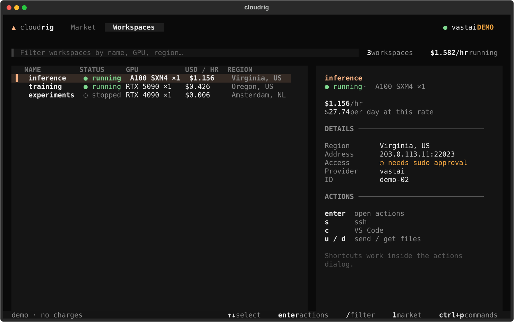

# Cloudrig

Rent a cloud GPU, upload your project, and open it in VS Code from your terminal.



## Try it

Download your platform wheel from [Releases](https://github.com/junuxyz/cloudrig/releases):

```sh
uv tool install ./cloudrig-*.whl
crig
```

Run `crig --demo` to preview without an account. Supports macOS and Linux.

[Get started](docs/getting-started.md) · [Agent setup](docs/agents.md) · [Command reference](docs/guide.md)

Experimental software built with AI assistance. See [verification status](docs/verification.md).

[MIT license](LICENSE) · [Contributing](CONTRIBUTING.md)
