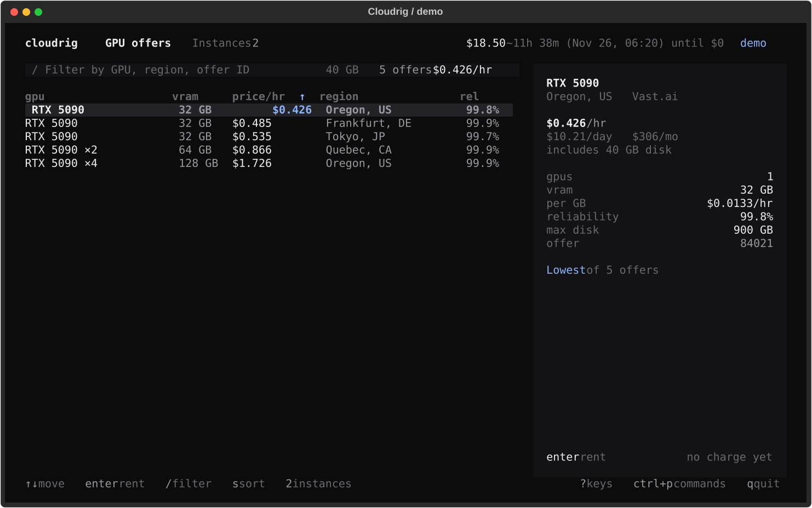

# Cloudrig

**Run cloud GPU experiments from your terminal — fast, simple, and agent-friendly.**

Run `crig` to open the interactive TUI and browse GPU offers or manage your rented GPUs.

<p align="center">
  
</p>

<p align="center">
  
</p>

## What you can do

- **Find a GPU**: Browse live Vast.ai offers and sort them by price, memory, or region.
- **Open VS Code on your GPU**: Select a rental and press `c`. Setup runs in the background, so you can keep working until VS Code opens. In our test, once the VS Code window appeared, warm start cut the median wait before you could edit and save a file from **20.9 seconds to 4.4 seconds**. [How warm start works](docs/architecture.md#vs-code-warm-start)
- **Control rentals with your PIN**: Agents can look up offers and check your rentals. For more sensitive actions like renting, stopping, or deleting a GPU, you enter your PIN. [Security details](docs/security.md)

## Get started

Setup takes two commands on macOS and Linux.

```sh
uv tool install git+https://github.com/junuxyz/cloudrig
crig
```

On your first run, Cloudrig asks for your Vast.ai API key and lets you choose a PIN. After that, `crig` opens the dashboard directly.

Try `crig --demo` without an account. A PyPI release is planned.

## Commands

```sh
crig                  # Open the dashboard (runs login on first use)
crig login            # Connect Vast.ai and set your PIN
crig logout           # Remove saved local keys
crig --gpu [QUERY]    # Browse GPU offers (e.g. crig --gpu 4090)
crig --rented         # List your rented GPUs
crig NAME code        # Open VS Code on a running GPU
crig NAME stop        # Stop a GPU (PIN required)
crig NAME destroy     # Delete a GPU (PIN required)
```

Add `--plain` or `--json` for script-friendly output. For example, `crig --rented --json` lists rented GPUs as JSON.

## License

[MIT license](LICENSE)
