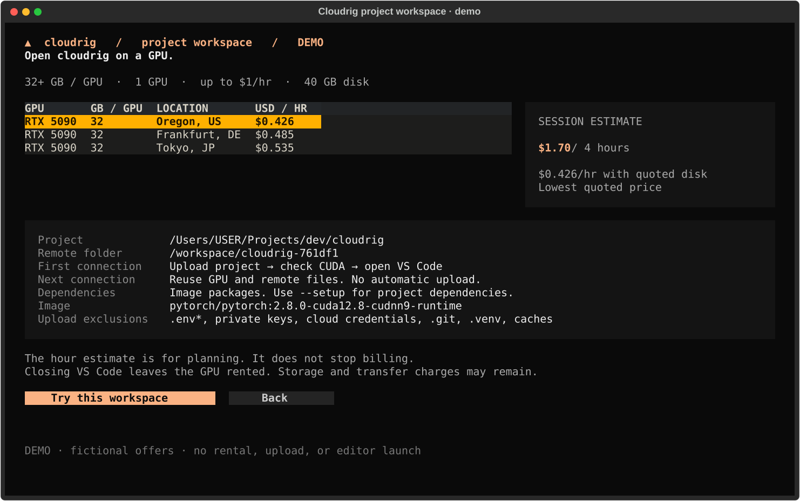

# Project workspaces

A workspace connects one local project to one rented GPU and remote folder. `crig up` rents once,
then reconnects to that instance. Setup failures and missing instances never trigger a replacement.

```sh
crig up /path/to/project --setup
```

Choose an offer in the project browser. Use `--numbered` for prompts or `--demo` for fictional
offers without rental, upload, editor launch, or configuration writes.



## Settings

No configuration file is required. `crig init PATH` writes defaults to `crig.toml`.
Command options override saved settings.

```toml
[workspace]
provider = "vastai"
vram = 32
count = 1
disk = 80
max_hourly = 0.80
hours = 4
# framework = "pytorch"
# startup = "scripts/startup.sh"
```

| Setting | Meaning |
| --- | --- |
| `provider` | New project rentals currently require Vast.ai. |
| `gpu`, `region` | Optional name and location substring filters. |
| `vram`, `count` | Minimum memory per GPU in GB and exact GPU count. |
| `disk` | Container disk in GB. |
| `max_hourly` | Search limit for compute plus disk, not a total-spending cap. |
| `hours` | Cost estimate only; it does not schedule shutdown. |
| `image` | Optional container image. |
| `framework` | `none` checks the NVIDIA driver; `pytorch` also checks CUDA in the project environment. |
| `startup` | Optional script replacing the default rsync/uv setup. Relative to the project. |

The helper rejects new rental quotes above the reviewed price. It does not lock future prices or
cap later charges. Storage and transfers can cost extra after compute stops.

## Preparation and files

The first connection uploads files, checks the GPU, and opens VS Code. `--setup` installs from
`uv.lock` or `requirements.txt`; other dependency managers need a custom script or manual setup.
Use `--no-code` to skip the editor or `--wait` to prepare in the current terminal.

Background progress appears in the dashboard. View setup or `g` shows events and errors.
Keep this computer awake and connected until preparation finishes. `crig status` prints saved
progress for scripts; neither view checks continuous GPU health.

Preview uploads with `crig plan PATH --files`. Transfers apply Git ignores, `.crigignore`, and
built-in filename exclusions. They exclude Git metadata, common credential files, environments,
and caches. They do not inspect file contents for secrets.

Later connections preserve remote edits and do not upload again. Use `crig NAME push LOCAL REMOTE`
or `crig NAME pull REMOTE LOCAL` for changes. Retrieve outputs before deleting the instance.

Startup scripts run before upload on each preparation. Write them to tolerate repeated execution.
An empty script skips startup. Remote logs are at `~/.cache/cloudrig/startup.log`.
Plain `crig NAME ssh` skips default startup for repair access.

## Recovery

Retry setup on the same instance. A completed upload is not repeated; an incomplete upload needs
confirmation. A saved binding keeps its provider after the global default changes.
Moving a project folder requires explicit reattachment.

For a lost rental response, check the provider console before following
[recovery commands](guide.md#recover-a-failed-setup-or-uncertain-rental).
Stop compute with `crig down PATH`. Closing the editor does not stop billing.

See [architecture](architecture.md), [verification](verification.md), and [design choices](workspace-research.md).
Regenerate previews with `uv run python scripts/preview.py`.
