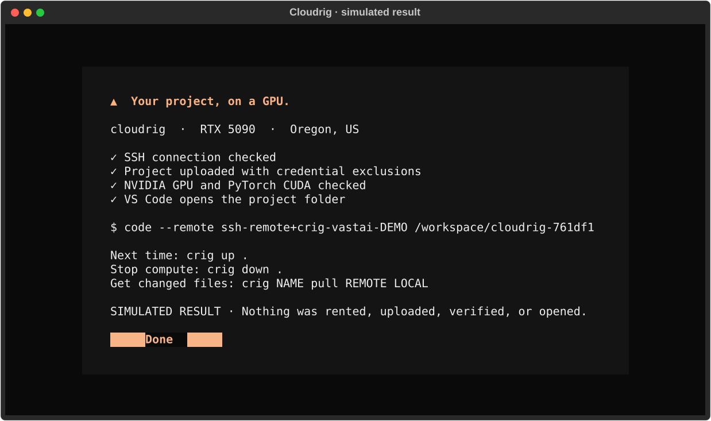

# Project workspace prototype

Branch: `project-first-workspaces`.

Try the actual terminal flow without an account:

```sh
cd /Users/USER/Projects/dev/cloudrig
uv run crig up . --demo --vram 32
```

Use the arrow keys to choose an offer. Enter focuses the review button; Enter again opens the
simulated result. Escape or `q` exits. No rental, SSH, upload, editor launch, or configuration write
occurs in demo mode.




## Live use

Complete the existing [installation and account setup](../README.md#install), then run:

```sh
crig init /path/to/project
crig plan /path/to/project
crig up /path/to/project
crig up /path/to/project       # Reconnect; keep remote edits
crig down /path/to/project     # Confirm and stop compute; disk charges may remain
```

The `crig.toml` file records defaults. Command-line values override it:

```toml
[workspace]
provider = "vastai"
vram = 32
count = 1
disk = 80
max_hourly = 0.80
hours = 4
# gpu = "5090"
# region = "JP"
```

`max_hourly` is a search filter on quoted compute plus disk. The protected helper shows a fresh
quote before rental. It is not a spending cap. `hours` is for planning and never shuts down the GPU.
The project launcher currently targets Vast's complete quotes. Runpod's adapter lacks a storage
quote, so its offers are excluded. Its existing market commands continue to work.

`crig plan --json`, `crig up --json`, and `crig up --plain` are read-only. Use `--offer ID` for a
plain terminal review followed by human approval, or leave it out for the interactive review.
Add `--no-code` to prepare without opening the editor.

The first `up` uploads this project with credential and cache exclusions. After upload, Cloudrig
checks NVIDIA and PyTorch CUDA access, then opens the remote project directory. Add `--setup` to
run the detected uv or requirements-file installer remotely. The remote image must include that
installer. A repeat `up` preserves remote edits and reuses its saved Python environment.

If setup is interrupted, `up` keeps the allocation and retries its unfinished preparation. It asks
before repeating an incomplete upload because matching remote files can be overwritten. After an
ambiguous rental response, inspect `crig --rented` and your provider console before using
`crig up --attach ID`. An instance must already have an approved connection before attachment.

If you cancelled before allocation, or verified that the old allocation was deleted, use
`crig forget PATH` to clear its local binding. This requires confirmation and never stops or deletes
anything at the provider. Check the provider account first because a later `up` may request a rental.

Use the existing `crig NAME pull REMOTE LOCAL` to retrieve remote changes and experiment outputs.
Closing VS Code does not stop billing. Stop with `crig down`; delete separately through the
existing privileged lifecycle command after retrieving your files.

For findings, alternatives, priorities, and verification limits, read
[the research and design review](workspace-research.md).

Regenerate SVG previews with `uv run python scripts/preview-workspace.py`.
